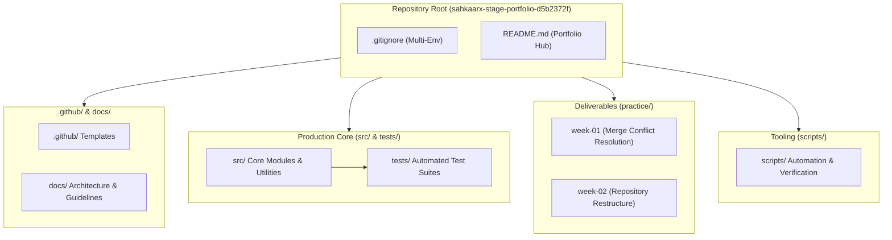

# Repository Architecture & Engineering Guidelines

## Executive Summary
The **SahkaarX Stage Portfolio** repository is structured as a scalable, production-grade mono-repository designed to showcase clean code practices, modular component organization, automated verification, and disciplined Git version control workflows.

---

## Architectural Principles

### 1. Separation of Concerns
Each directory has a single, unambiguous responsibility:
- **`src/`**: Houses production-ready source code, core business logic, and reusable application modules.
- **`tests/`**: Contains automated unit, integration, and structural validation suites mirroring the package structure.
- **`practice/`**: Isolates chronological stage deliverables and weekly technical challenges without polluting production source paths.
- **`scripts/`**: Houses devops automation, build/release utilities, and repository verification scripts.
- **`docs/`**: Central repository documentation, architectural decision records (ADRs), and contributor guidelines.
- **`.github/`**: Automation workflows, issue forms, and pull request review templates.

### 2. Modularity & Extensibility
Modules under `src/` follow package encapsulation standards using explicit `__init__.py` exports and type-annotated APIs. Utilities like logging and environment handling are centralized to prevent redundant re-implementation across practice modules.

### 3. Atomic Version Control & Governance
Every architectural iteration is backed by atomic Git commits adhering to the [Conventional Commits](https://www.conventionalcommits.org/) specification (`feat`, `fix`, `refactor`, `docs`, `chore`, `test`). Branching follows a feature-branch workflow with protected base branches.

---

## Architecture Flow Diagram

---

## Code Quality & CI/CD Readiness
- **Formatting & Style**: PEP 8 compliance for Python modules.
- **Static Analysis**: Type hints and modular imports.
- **Continuous Integration**: Verification scripts in `scripts/verify_structure.py` ready for GitHub Actions automation.
