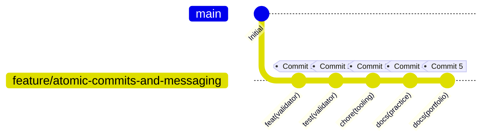

# Engineering Guide: Atomic Commits and Clear Messaging

> **Repository**: [parth-mehta95/sahkaarx-stage-portfolio-d5b2372f](https://github.com/parth-mehta95/sahkaarx-stage-portfolio-d5b2372f)  
> **Feature Branch**: [`feature/atomic-commits-and-messaging`](https://github.com/parth-mehta95/sahkaarx-stage-portfolio-d5b2372f/tree/feature/atomic-commits-and-messaging)  
> **Standard**: [Conventional Commits v1.0.0](https://www.conventionalcommits.org/en/v1.0.0/)

---

## 1. What is an Atomic Commit?

An **atomic commit** is a Git commit that encapsulates a single, indivisible, logical unit of work. Like an atom, it cannot be broken down further without losing its complete meaning or breaking the system.

### Core Principles
1. **Single Responsibility Principle (SRP)**: Each commit answers exactly *one* question or addresses *one* concern. It never bundles unrelated changes (such as fixing a bug while simultaneously reformatting styles and updating dependencies).
2. **Always Compilable & Passing Tests**: Every individual commit in the history must leave the repository in a stable, buildable state where all tests pass. If you checkout any past commit, the test suite runs green.
3. **Revertable**: If a specific change causes a regression in staging or production, that single commit can be cleanly reverted (`git revert <hash>`) without destroying unrelated features or refactorings.
4. **Bisect-Friendly**: When debugging using `git bisect`, atomic commits allow automated binary search to pinpoint the exact commit and line of code that introduced a failure.

---

## 2. The Conventional Commits Specification

This repository enforces the **Conventional Commits v1.0.0** specification, a lightweight convention on top of commit messages providing an easy set of rules for creating an explicit commit history.

### Message Anatomy

```text
<type>(<scope>): <subject>

[optional body]

[optional footer(s)]
```

### Visual Breakdown

```text
feat(validator): implement conventional commit parser and validator engine
│    │           │
│    │           └─ Short, imperative description (<= 72 chars, no trailing period)
│    └───────────── Scope indicating subsystem affected (optional, e.g. validator, auth, ci)
└────────────────── Type describing intention (feat, fix, docs, chore, etc.)
```

### Allowed Commit Types

| Type | Intent | Example |
| :--- | :--- | :--- |
| `feat` | Introduces a new feature or capability | `feat(api): add jwt token revocation endpoint` |
| `fix` | Patches a bug or addresses an edge case failure | `fix(cache): resolve race condition in redis pool` |
| `docs` | Documentation changes only | `docs(readme): clarify local development setup steps` |
| `style` | Formatting, whitespace, semicolon changes (no code behavior change) | `style(logger): format import blocks according to pep8` |
| `refactor` | Code restructuring without fixing a bug or adding a feature | `refactor(auth): extract token verification into helper class` |
| `perf` | Code changes that improve runtime performance or memory | `perf(query): add database index to user lookup table` |
| `test` | Adding missing unit/integration tests or correcting existing tests | `test(validator): add test cases for header length boundary` |
| `build` | Changes to build tools, dependency versions, or packaging | `build(deps): bump python dependencies to latest patch` |
| `ci` | Modifications to CI/CD workflows and automated pipelines | `ci(github): add matrix test runner for python 3.10 and 3.11` |
| `chore` | Routine repository maintenance, tooling, or internal scripts | `chore(tooling): add automated git history verifier` |
| `revert` | Reverts a previously merged commit | `revert: revert feat(api) due to regression in downstream service` |

---

## 3. Writing Clear, Descriptive Messages

### The Imperative Mood Rule
Always write the commit subject in the **imperative mood** (present tense imperative). A helpful rule of thumb is to complete this sentence:

> *"If applied, this commit will `<subject>`"*

| ❌ Non-Imperative / Bad | ✅ Imperative / Best Practice | Rationale |
| :--- | :--- | :--- |
| `added commit validator` | `feat(validator): implement conventional commit parser` | Standard Git command voice; indicates future-applied action. |
| `fixes bug in auth` | `fix(auth): handle expired jwt token gracefully` | Explains what the code actually does and which component. |
| `updated docs` | `docs(practice): document atomic commit principles and audit` | Specific about which guide was added. |
| `WIP: working on stuff` | `feat(core): initialize modular src package` | Clear deliverable, avoids vague temporary placeholders. |
| `fixed issues.` | `fix(tests): resolve assertion failure on windows paths` | Avoids trailing punctuation; gives context. |

### Header Formatting Rules
1. **Length**: Keep the subject under 72 characters (ideally under 50 characters).
2. **Casing**: Lowercase type and scope; capitalize or lowercase description consistently, but do not use ALL CAPS.
3. **Punctuation**: Never place a period (`.`) at the end of the subject line.
4. **Blank Line Before Body**: When adding a multi-line body, always separate the subject from the body with an empty line.

---

## 4. Deconstructing the Feature Branch Workflow

For this practice, the feature branch [`feature/atomic-commits-and-messaging`](https://github.com/parth-mehta95/sahkaarx-stage-portfolio-d5b2372f/tree/feature/atomic-commits-and-messaging) demonstrates a complete, real-world utility: **The SahkaarX Commit Hygiene and History Verification Engine**.

Instead of bundling everything into one monolithic commit, the work is cleanly divided into **5 atomic commits**:



### Commit Separation Matrix

```text
+----------------------------------------------------------------------------------------------------+
| 1. feat(validator): implement conventional commit parser and validator engine                      |
|    - Target: src/utils/commit_validator.py, src/utils/__init__.py                                  |
|    - Scope: Pure business logic only. No tests, no build scripts, no unrelated docs.              |
+----------------------------------------------------------------------------------------------------+
| 2. test(validator): add comprehensive unit test suite for commit validation rules                  |
|    - Target: tests/test_commit_validator.py                                                        |
|    - Scope: Unit tests proving correctness of the validator engine across 12+ test cases.         |
+----------------------------------------------------------------------------------------------------+
| 3. chore(tooling): add automated git history verifier and workflow runner                          |
|    - Target: scripts/verify_commit_history.py, scripts/run_atomic_commits_practice.ps1            |
|    - Scope: CLI verification tooling and branch automation runner.                                 |
+----------------------------------------------------------------------------------------------------+
| 4. docs(practice): document atomic commit principles, workflow guide, and history audit             |
|    - Target: practice/week-02-practice-atomic-commits-and-clear-messaging/                         |
|    - Scope: Educational guide, audit logs, and delivery documentation for team review.             |
+----------------------------------------------------------------------------------------------------+
| 5. docs(portfolio): register atomic commits practice in portfolio index and update structure checks|
|    - Target: README.md, tests/test_repo_structure.py, scripts/verify_structure.py                  |
|    - Scope: Top-level repository navigation and integration with CI assertions.                    |
+----------------------------------------------------------------------------------------------------+
```

---

## 5. Verification & Review Commands

To review this feature branch locally:

```powershell
# 1. Switch to the feature branch
git checkout feature/atomic-commits-and-messaging

# 2. View clean commit graph
git log --graph --oneline --decorate -n 10

# 3. View detailed commit messages and author metadata
git log -n 5 --pretty=format:"%h - %an (%ar): %s%n%b"

# 4. Run automated commit history verification
python scripts/verify_commit_history.py

# 5. Run test suite
python -m unittest discover tests/
```
