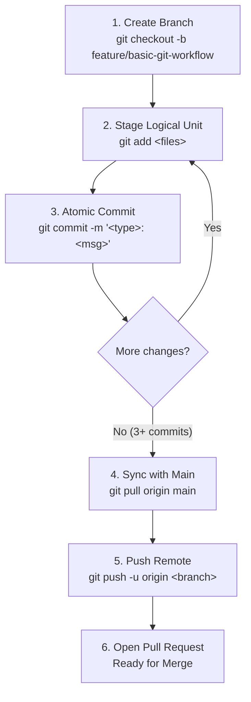

# Engineering Guide: Basic Git Workflow with Multiple Atomic Commits

> **Repository**: [parth-mehta95/sahkaarx-stage-portfolio-d5b2372f](https://github.com/parth-mehta95/sahkaarx-stage-portfolio-d5b2372f)  
> **Feature Branch**: [`feature/basic-git-workflow`](https://github.com/parth-mehta95/sahkaarx-stage-portfolio-d5b2372f/tree/feature/basic-git-workflow)  
> **Target Standard**: Core Git Workflow Lifecycle (`add`, `commit`, `pull`, `push`) with Atomic Commits  

---

## 1. Architectural Model of Git's Three States

Git manages files through three primary structural zones:

```text
┌─────────────────────────┐       ┌─────────────────────────┐       ┌─────────────────────────┐
│    Working Directory    │ ----> │    Staging Area / Index │ ----> │   Git Repository (.git) │
│  (Modified Uncommitted) │  add  │   (Prepared Snapshot)   │ commit│  (Permanent History)   │
└─────────────────────────┘       └─────────────────────────┘       └─────────────────────────┘
            ▲                                                                    │
            │                                                                    ▼
            └───────────────────────── git pull ───────────────────────── Remote (GitHub)
```

1. **Working Directory**: The actual sandbox files on your local filesystem being edited.
2. **Staging Area (Index)**: A binary snapshot staging index where selected files are queued via `git add` to formulate the next logical commit.
3. **Repository History**: The immutable directed acyclic graph (DAG) of commit objects created by `git commit`.
4. **Remote Tracking (`origin`)**: The shared repository on GitHub synchronized using `git push` and `git pull`.

---

## 2. Core Git Commands Deep Dive

### Phase 1: Branch Isolation (`git checkout -b`)
Developing directly on `main` introduces risks of unreviewed regressions and broken CI pipelines.
```bash
# Create and immediately checkout the feature branch
git checkout -b feature/basic-git-workflow
```
*Rationale*: Isolates work from production code, enabling independent review and conflict-free experimentation.

---

### Phase 2: Selective Staging (`git add`)
The staging area allows engineering discipline by separating work into focused units:
```bash
# Stage only the files relevant to the current logical unit
git add src/utils/git_ops.py src/utils/__init__.py
```
*Best Practice*: Never use generic blanket staging (`git add .`) when preparing atomic commits. Stage only the specific files or hunks (`git add -p`) that belong to that exact purpose.

---

### Phase 3: Atomic Snapshot Creation (`git commit`)
A commit records an immutable snapshot of the staging area with a standardized message:
```bash
git commit -m "feat(git-ops): implement core git workflow management module"
```
*Atomic Criteria*:
- Single responsibility: Each commit solves one problem.
- Always functional: Code builds and unit tests pass on every single commit.
- Clear imperative summary: Explains *what* the commit does when applied.

---

### Phase 4: Upstream Synchronization (`git pull`)
Before publishing code or submitting a Pull Request, the feature branch must sync with `origin/main` to absorb updates made by team members:
```bash
git pull origin main --no-rebase
```
*Why this is critical*:
- Eliminates stale branches.
- Surfaces and resolves potential merge conflicts locally in the feature branch before opening a Pull Request.
- Guarantees that the feature branch can be cleanly merged by GitHub without blocking reviewers.

---

### Phase 5: Remote Publication (`git push`)
Publishes local commits to GitHub and binds upstream tracking:
```bash
git push -u origin feature/basic-git-workflow
```
*Flags*:
- `-u` (`--set-upstream`): Establishes a tracking reference between local `feature/basic-git-workflow` and `origin/feature/basic-git-workflow`, allowing future commands to be simply `git push` or `git pull`.

---

## 3. The 5-Step Code Review Workflow Lifecycle



---

## 4. Pull Request Review Checklist

Prior to requesting code reviews:
- [x] Branch is branched from latest `main`.
- [x] 3 or more atomic commits with clear Conventional Commit subjects.
- [x] All unit tests pass cleanly (`python -m unittest discover tests/`).
- [x] Working tree is completely clean (`git status` shows 0 uncommitted changes).
- [x] Branch is synced with upstream `main` via `git pull`.
- [x] Remote branch is pushed and verifiable on GitHub.
